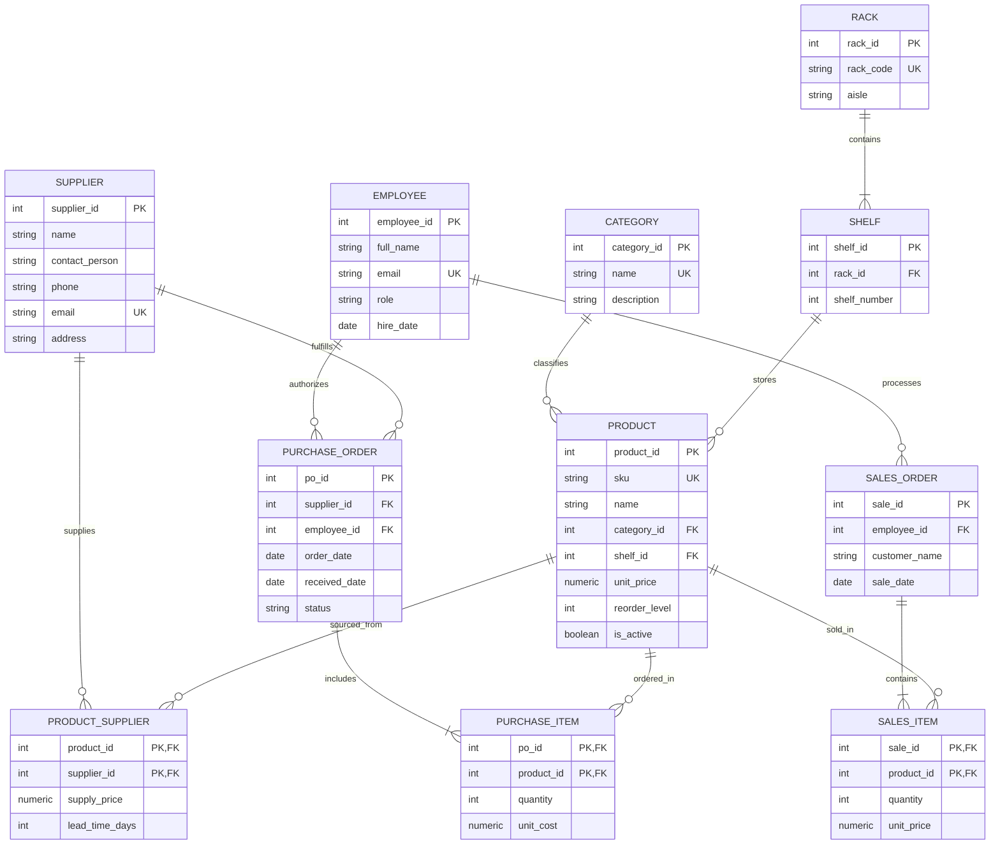

# Retail Inventory & Warehouse Rack Management System (RackMaster)
## Complete Project Viva Preparation Handbook & Examiner's Master Guide

**Target Evaluation**: College DBMS Laboratory Viva, Project Defense, and Technical Evaluation  
**Authoritative Persona**: Senior DBMS Professor & University Technical Viva Examiner  
**Database Engine**: PostgreSQL 15+ (Hosted on Supabase Cloud)  
**Backend Framework**: Python 3 / Flask (Modular RESTful Architecture)  
**Frontend Stack**: React 19 / Vite / Tailwind CSS  

---

# Table of Contents
1. [Section 1: Database Schema & Relational Table Blueprint](#section-1-database-schema--relational-table-blueprint)
   - 1.1 What is a Database Schema?
   - 1.2 Comprehensive Table-by-Table Breakdown (All 11 Tables)
   - 1.3 Key Definitions: Primary, Foreign, Candidate, and Composite Keys
   - 1.4 Normalization Analysis (1NF, 2NF, 3NF Proofs)
   - 1.5 Referential Integrity & Cascading Actions (RESTRICT, CASCADE, SET NULL)
   - 1.6 Table-Specific Examiner Viva Questions & Answers
2. [Section 2: Entity-Relationship (ER) Architecture](#section-2-entity-relationship-er-architecture)
   - 2.1 What is an ER Diagram?
   - 2.2 Formal Entities, Attributes, and Classifications
   - 2.3 Relationship Cardinalities & Structural Participation (1:1, 1:N, M:N)
   - 2.4 Complete Mermaid ER Diagram
   - 2.5 Converting the Conceptual ER Model into Relational Physical Tables
   - 2.6 Tough Viva Questions on Relational Modeling
3. [Section 3: SQL Queries – In-Depth Academic Analysis](#section-3-sql-queries--in-depth-academic-analysis)
   - 3.1 Overview of Query Clauses & Execution Order
   - 3.2 Query 1: Product Search & Location Filter (`01_product_search.sql`)
   - 3.3 Query 2: Low-Stock Shortfall & Reorder Alerts (`02_low_stock.sql`)
   - 3.4 Query 3: Multi-Table Store Inventory Valuation (`04_stock_value_by_category.sql`)
   - 3.5 Query 4: Inbound Procurement & Purchase Order Tracking (`05_purchase_order_summary.sql`)
   - 3.6 Query 5: Outbound Sales, Revenue, & Margin Calculations (`06_sales_summary.sql`)
   - 3.7 Query 6: Supplier Catalog & Lead-Time Analysis (`07_supplier_products.sql`)
   - 3.8 Query 7: Advanced Subqueries (Scalar & Set Membership) (`11_advanced_subqueries.sql`)
   - 3.9 Query 8 & 9: Transactional CRUD & Soft Deactivation (`08_insert_product.sql`, `10_delete_product.sql`)
   - 3.10 Mathematical Business Logic: Step-by-Step Numerical Examples
4. [Section 4: Database Views – Abstraction & Dynamic Computation](#section-4-database-views--abstraction--dynamic-computation)
   - 4.1 What is a View? (Simple vs Complex, Base vs Derived)
   - 4.2 Deep Dive: `product_stock` View (Derived Inventory Calculus)
   - 4.3 Deep Dive: `product_location` View (Physical Warehouse Mapping)
   - 4.4 Updatability of Views & Base Table Ripple Effects
   - 4.5 Examiner Viva Questions on Database Views
5. [Section 5: Frontend Architecture & Client Implementation](#section-5-frontend-architecture--client-implementation)
   - 5.1 Technology Stack & Architectural Decisions
   - 5.2 Component Hierarchy & State Lifecycle (`useState`, `useEffect`)
   - 5.3 Interactive Quick Sale Modal & Real-Time Margin Calculus
   - 5.4 Search, Debouncing, and Dynamic Filtering
   - 5.5 Client-Side Error Trapping & Form Validation
6. [Section 6: Backend Architecture & Server-Side Integration](#section-6-backend-architecture--server-side-integration)
   - 6.1 Flask Blueprint Modular Architecture
   - 6.2 Connection Pooling & Client Isolation (`psycopg2.pool`)
   - 6.3 Secure Parameterized Query Execution & SQL Injection Mitigation
   - 6.4 The `BEFORE INSERT` Trigger: Enforcing Negative-Stock Guards
   - 6.5 Safe Sequential ID Allocation & Concurrency Guarding
7. [Section 7: End-to-End Enterprise Workflows](#section-7-end-to-end-enterprise-workflows)
   - 7.1 Workflow A: Procurement Cycle (Supplier -> PO -> Stock In)
   - 7.2 Workflow B: Outbound Point-of-Sale Checkout & Automatic Stock Reduction
   - 7.3 Workflow C: Dynamic Warehouse Re-Rack & Shelf Reallocation
   - 7.4 Information Flow Anatomy: React -> Flask -> PostgreSQL -> React
8. [Section 8: Core DBMS Theory & Viva Examination Question Bank](#section-8-core-dbms-theory--viva-examination-question-bank)
   - 8.1 DBMS vs RDBMS & PostgreSQL vs MySQL Architecture
   - 8.2 SQL Classification: DDL, DML, DCL, TCL
   - 8.3 ACID Properties: Theoretical Rigor in Enterprise Systems
   - 8.4 Database Indexing (B-Tree, Foreign Key Optimization, Clustered vs Non-Clustered)
   - 8.5 Stored Procedures, Functions, and Triggers
   - 8.6 Concurrency Control, Lock Modes, and Transaction Isolation Levels
   - 8.7 Master Bank of 50 High-Frequency Viva Questions with Answers

---

# Section 1: Database Schema & Relational Table Blueprint

### 1.1 What is a Database Schema?
In Database Management Systems, a **Database Schema** represents the formal structural design, skeletal architecture, and blueprint of the database. It defines:
1. The **entities** (tables).
2. The **attributes** (columns) and their domain **data types** (integers, characters, decimals, timestamps).
3. The **integrity constraints** (primary keys, unique constraints, check constraints, default values, non-null requirements).
4. The **relational mappings** and referential integrity rules (foreign keys and cascading rules).

A schema defines the database structure at the **logical level**, whereas the actual rows residing inside the tables at any given moment represent the **database instance** (or database state).

---

### 1.2 Comprehensive Table-by-Table Breakdown (All 11 Tables)
Our database consists of **11 relational tables**, strictly arranged from independent parent tables to associative and transaction line-item tables.

```
      +----------------+       +---------------+       +--------------+
      |    employee    |       |   category    |       |     rack     |
      +-------+--------+       +-------+-------+       +------+-------+
              |                        |                      |
              |                        |                      v
              |                        |               +--------------+
              |                        |               |    shelf     |
              |                        |               +------+-------+
              |                        |                      |
              |                        +--------+-------------+
              |                                 |
              |                                 v
              |                        +----------------+
              |                        |    product     |<-------------+
              |                        +---+--------+---+              |
              |                            |        |                  |
              +-------------+              |        |                  |
              |             |              |        |                  |
              v             v              v        v                  |
      +---------------+ +-------------+  +------------+  +-------------+----+
      |purchase_order | | sales_order |  |purchase_item| |product_supplier  |
      +-------+-------+ +------+------+  +------------+  +-------------+----+
              |                |                                       ^
              v                v                                       |
      +---------------+ +-------------+                        +-------+----+
      | purchase_item | | sales_item  |                        |  supplier  |
      +---------------+ +-------------+                        +------------+
```

---

#### Table 1: `employee` (System Users & Warehouse Staff)
- **Purpose**: Represents internal human actors who authorize procurement purchase orders and execute customer point-of-sale transactions.
- **Columns**:
  - `employee_id` (`SERIAL PRIMARY KEY`): Unique surrogate identifier auto-incremented by the database sequence.
  - `full_name` (`VARCHAR(100) NOT NULL`): Employee's legal name.
  - `email` (`VARCHAR(120) NOT NULL UNIQUE`): Unique email address used for identification and preventing duplicate accounts.
  - `role` (`VARCHAR(20) NOT NULL CHECK (role IN ('Admin', 'Manager', 'Staff'))`): Role-based security attribute restricted by domain constraint.
  - `hire_date` (`DATE NOT NULL DEFAULT CURRENT_DATE`): Employment commencement date automatically populated if omitted.

---

#### Table 2: `category` (Merchandise Grouping)
- **Purpose**: Categorizes retail products (e.g., Electronics, Stationery, Hardware) to enable category-wise aggregated valuation and search filtering.
- **Columns**:
  - `category_id` (`SERIAL PRIMARY KEY`): Unique identifier for the merchandise category.
  - `name` (`VARCHAR(60) NOT NULL UNIQUE`): Unique category title. Duplicate category names are rejected at the storage layer.
  - `description` (`TEXT`): Extended documentation describing the category range.

---

#### Table 3: `supplier` (Wholesale Vendors)
- **Purpose**: Stores external business entities that supply products to the retail store via purchase orders.
- **Columns**:
  - `supplier_id` (`SERIAL PRIMARY KEY`): Unique supplier identifier.
  - `name` (`VARCHAR(100) NOT NULL`): Legal business or trade name.
  - `contact_person` (`VARCHAR(100)`): Direct representative or sales agent.
  - `phone` (`VARCHAR(20) NOT NULL`): Primary telephonic contact.
  - `email` (`VARCHAR(120) UNIQUE`): Official contact email.
  - `address` (`TEXT`): Warehouse or office dispatch location.

---

#### Table 4: `rack` (Physical Warehouse Aisle Structures)
- **Purpose**: Represents physical structural steel shelving units located throughout the warehouse aisles.
- **Columns**:
  - `rack_id` (`SERIAL PRIMARY KEY`): Unique numeric rack identifier.
  - `rack_code` (`VARCHAR(10) NOT NULL UNIQUE`): Short barcode identifier (e.g., `R01`, `R02`, `R03`).
  - `aisle` (`VARCHAR(20) NOT NULL`): Warehouse section or pathway code (e.g., `Aisle 1`, `Aisle 2`).

---

#### Table 5: `shelf` (Vertical Storage Tiers)
- **Purpose**: Models the physical vertical levels/tiers inside a specific rack (1 Rack : N Shelves).
- **Columns**:
  - `shelf_id` (`SERIAL PRIMARY KEY`): Unique identifier for the individual shelf tier.
  - `rack_id` (`INT NOT NULL REFERENCES rack(rack_id) ON UPDATE CASCADE ON DELETE CASCADE`): Foreign key pointing to the parent rack. If a rack is demolished, its constituent shelves are automatically removed.
  - `shelf_number` (`INT NOT NULL CHECK (shelf_number > 0)`): Tier level indicator (e.g., Level 1, Level 2).
- **Composite Unique Constraint**: `UNIQUE (rack_id, shelf_number)`. Prevents accidental creation of two identical shelf tiers inside the same physical rack.

---

#### Table 6: `product` (Core Catalog Entity)
- **Purpose**: Defines master catalog items, retail selling prices, and reorder levels.
- **Architectural Highlight**: Notice that `current_stock` is **NOT** stored as a column here. Stock is an operational quantity dynamically computed from confirmed procurement receipts minus customer sales. This avoids data anomalies.
- **Columns**:
  - `product_id` (`SERIAL PRIMARY KEY`): Master unique numeric product key.
  - `sku` (`VARCHAR(30) NOT NULL UNIQUE`): Stock Keeping Unit string (e.g., `EL001`, `ST101`).
  - `name` (`VARCHAR(120) NOT NULL`): Catalog item display name.
  - `category_id` (`INT NOT NULL REFERENCES category(category_id) ON UPDATE CASCADE ON DELETE RESTRICT`): Foreign key to category. Categories with active products cannot be deleted.
  - `shelf_id` (`INT REFERENCES shelf(shelf_id) ON UPDATE CASCADE ON DELETE SET NULL`): Physical storage location. If a shelf is removed, the product remains in the catalog with location set to `NULL`.
  - `unit_price` (`NUMERIC(10,2) NOT NULL CHECK (unit_price >= 0)`): Retail selling price (MSRP) to customers.
  - `reorder_level` (`INT NOT NULL DEFAULT 10 CHECK (reorder_level >= 0)`): Minimum safety inventory threshold triggering low-stock alerts.
  - `is_active` (`BOOLEAN NOT NULL DEFAULT TRUE`): Soft-delete flag preserving referential integrity.

---

#### Table 7: `product_supplier` (Associative M:N Sourcing Table)
- **Purpose**: Resolves the many-to-many relationship between products and suppliers. One supplier can supply multiple products; one product can be sourced from multiple competing vendors with different wholesale prices and lead times.
- **Columns**:
  - `product_id` (`INT NOT NULL REFERENCES product(product_id) ON UPDATE CASCADE ON DELETE CASCADE`): Foreign key to product.
  - `supplier_id` (`INT NOT NULL REFERENCES supplier(supplier_id) ON UPDATE CASCADE ON DELETE CASCADE`): Foreign key to supplier.
  - `supply_price` (`NUMERIC(10,2) NOT NULL CHECK (supply_price >= 0)`): Contractual wholesale buy price from this specific supplier.
  - `lead_time_days` (`INT CHECK (lead_time_days >= 0)`): Procurement delivery latency in days.
- **Composite Primary Key**: `PRIMARY KEY (product_id, supplier_id)`.

---

#### Table 8: `purchase_order` (Procurement Stock-In Header)
- **Purpose**: Represents an inbound purchase contract with a vendor to replenish store stock.
- **Columns**:
  - `po_id` (`SERIAL PRIMARY KEY`): Unique Purchase Order tracking number.
  - `supplier_id` (`INT NOT NULL REFERENCES supplier(supplier_id) ON UPDATE CASCADE ON DELETE RESTRICT`): Foreign key to supplier vendor.
  - `employee_id` (`INT NOT NULL REFERENCES employee(employee_id) ON UPDATE CASCADE ON DELETE RESTRICT`): Staff member who authorized the PO.
  - `order_date` (`DATE NOT NULL DEFAULT CURRENT_DATE`): Order issuance date.
  - `received_date` (`DATE`): Warehouse dock receipt verification date.
  - `status` (`VARCHAR(15) NOT NULL DEFAULT 'Pending' CHECK (status IN ('Pending', 'Received', 'Cancelled'))`): Operational state. Only when status becomes `'Received'` does incoming stock count towards inventory.
- **Table Constraint**: `CHECK (received_date IS NULL OR received_date >= order_date)`. Prevents temporal anomalies where goods are marked received before they were ordered.

---

#### Table 9: `purchase_item` (Procurement Line-Item Details)
- **Purpose**: Breaks down a purchase order into individual product quantities and agreed unit costs.
- **Columns**:
  - `po_id` (`INT NOT NULL REFERENCES purchase_order(po_id) ON UPDATE CASCADE ON DELETE CASCADE`): Foreign key to the parent PO header.
  - `product_id` (`INT NOT NULL REFERENCES product(product_id) ON UPDATE CASCADE ON DELETE RESTRICT`): Foreign key to product.
  - `quantity` (`INT NOT NULL CHECK (quantity > 0)`): Ordered physical unit count.
  - `unit_cost` (`NUMERIC(10,2) NOT NULL CHECK (unit_cost >= 0)`): Wholesale unit acquisition cost.
- **Composite Primary Key**: `PRIMARY KEY (po_id, product_id)`.

---

#### Table 10: `sales_order` (Outbound Point-of-Sale Header)
- **Purpose**: Records customer checkout invoices.
- **Columns**:
  - `sale_id` (`SERIAL PRIMARY KEY`): Unique invoice number.
  - `employee_id` (`INT NOT NULL REFERENCES employee(employee_id) ON UPDATE CASCADE ON DELETE RESTRICT`): Cashier or sales staff.
  - `customer_name` (`VARCHAR(100)`): Customer identifier or `'Walk-in Customer'`.
  - `sale_date` (`DATE NOT NULL DEFAULT CURRENT_DATE`): Transaction timestamp.

---

#### Table 11: `sales_item` (Outbound POS Line-Item Details)
- **Purpose**: Itemized lines of products, quantities, and realized checkout prices for each invoice.
- **Columns**:
  - `sale_id` (`INT NOT NULL REFERENCES sales_order(sale_id) ON UPDATE CASCADE ON DELETE CASCADE`): Foreign key to parent sale invoice.
  - `product_id` (`INT NOT NULL REFERENCES product(product_id) ON UPDATE CASCADE ON DELETE RESTRICT`): Foreign key to product.
  - `quantity` (`INT NOT NULL CHECK (quantity > 0)`): Units purchased by customer.
  - `unit_price` (`NUMERIC(10,2) NOT NULL CHECK (unit_price >= 0)`): Actual billed price per unit at moment of checkout.
- **Composite Primary Key**: `PRIMARY KEY (sale_id, product_id)`.

---

### 1.3 Key Definitions: Primary, Foreign, Candidate, and Composite Keys

| Key Classification | Formal Definition | Concrete Example from Our Database |
| :--- | :--- | :--- |
| **Candidate Key** | A minimal set of attributes that can uniquely identify a tuple in a relation. | In `product`: `{product_id}` is a candidate key, and `{sku}` is also an alternate candidate key. |
| **Primary Key** | The specific candidate key chosen by the database designer to uniquely identify each tuple. Must be `NOT NULL` and `UNIQUE`. | `product.product_id`, `employee.employee_id`, `rack.rack_id`. |
| **Foreign Key** | An attribute or collection of attributes in a referencing relation that refers to the primary key of a referenced relation. | `shelf.rack_id` referencing `rack.rack_id`; `product.category_id` referencing `category.category_id`. |
| **Composite Key** | A key formed by combining two or more attributes together to achieve unique tuple identification. | In `purchase_item`: `(po_id, product_id)`; In `product_supplier`: `(product_id, supplier_id)`. |

---

### 1.4 Normalization Analysis (1NF, 2NF, 3NF Proofs)

A core evaluation criterion in any DBMS viva is proving that your schema satisfies **Third Normal Form (3NF)**.

#### 1. First Normal Form (1NF)
- **Condition**: A relation is in 1NF if and only if all underlying domains contain only **atomic (indivisible) values**, and there are no repeating groups or arrays.
- **Project Proof**:
  - We do not store comma-separated lists of products inside `purchase_order` or `sales_order`.
  - Instead, individual line items are modeled as distinct atomic rows inside separate child relations (`purchase_item`, `sales_item`).
  - No column stores composite phone numbers or arrays. Every attribute contains a single atomic scalar.
  - Hence, the schema satisfies 1NF.

#### 2. Second Normal Form (2NF)
- **Condition**: A relation is in 2NF if it is in 1NF and **every non-prime attribute is fully functionally dependent on the entire candidate key** (no partial functional dependencies on composite keys).
- **Project Proof**:
  - Consider our composite key tables: `purchase_item(po_id, product_id)`.
  - The non-prime attributes are `quantity` and `unit_cost`.
  - Is `quantity` dependent only on `po_id`? No, because a PO has multiple products.
  - Is `quantity` dependent only on `product_id`? No, because a product appears on multiple POs.
  - `quantity` and `unit_cost` depend strictly on the **combination** `{po_id, product_id}`.
  - Product descriptive attributes (like `product_name`, `sku`, `unit_price`) are NOT stored in `purchase_item`; they reside cleanly in `product`.
  - Hence, there are zero partial dependencies; the schema satisfies 2NF.

#### 3. Third Normal Form (3NF)
- **Condition**: A relation is in 3NF if it is in 2NF and **no non-prime attribute is transitively dependent on the primary key** (for every functional dependency $X \rightarrow Y$, either $X$ is a superkey or $Y$ is a prime attribute).
- **Project Proof**:
  - In `product`, the primary key is `product_id`.
  - We store `category_id`, but we do **not** store `category_name` or `category_description` in `product`.
  - If we had included `category_name` in `product`, we would have had the transitive dependency:  
    `product_id` $\rightarrow$ `category_id` $\rightarrow$ `category_name`.
  - Modifying a category's name would then cause update anomalies across thousands of product rows.
  - By separating `category` into its own table, every non-prime attribute depends directly on the primary key, and nothing but the primary key.
  - The same applies to `shelf` and `rack`.
  - Hence, the schema satisfies 3NF.

---

### 1.5 Referential Integrity & Cascading Actions

Referential integrity guarantees that foreign key relationships remain valid and that the database never contains orphaned records. Our project implements three distinct cascading strategies based on real-world business rules:

1. **`ON DELETE CASCADE`**:
   - *Where used*: `shelf(rack_id)`, `purchase_item(po_id)`, `sales_item(sale_id)`, `product_supplier(product_id, supplier_id)`.
   - *Why*: A purchase line item has no semantic meaning without its parent purchase order header. Deleting the order automatically deletes all associated lines.
2. **`ON DELETE RESTRICT`**:
   - *Where used*: `product(category_id)`, `purchase_order(supplier_id)`, `sales_order(employee_id)`, `sales_item(product_id)`.
   - *Why*: Prevents deleting a product that has historical sales or purchase records. Deleting such a product would corrupt revenue history and financial audits. The engine blocks the operation and raises an error.
3. **`ON DELETE SET NULL`**:
   - *Where used*: `product(shelf_id)`.
   - *Why*: If a physical shelf breaks or is dismantled, the products stored on it are not destroyed. They remain active in the store catalog with their storage coordinates temporarily set to `NULL` (unassigned).

---

### 1.6 Table-Specific Examiner Viva Questions & Answers

**Q1: Why did you split Purchase Orders and Sales Orders into two tables each (`purchase_order`/`purchase_item` and `sales_order`/`sales_item`)?**
> **Answer**: To satisfy First and Second Normal Forms (1NF and 2NF). A single purchase order or customer checkout invoice contains multiple line items. Storing multiple items in one row would require repeating groups or non-atomic comma-separated strings (violating 1NF). Putting order-level metadata (such as customer name or order date) on every item line would duplicate data and introduce insertion, deletion, and update anomalies. Separating Header (1) and Items (N) creates a clean 1:N relationship.

**Q2: Why is `current_stock` not stored as a regular column inside the `product` table?**
> **Answer**: Storing `current_stock` as a static column creates a **redundant derived attribute** that easily falls out of sync during concurrent sales or deliveries. In our architecture, stock is calculated dynamically via the `product_stock` database view:  
> `stock_quantity = (Total Received from Received Purchase Orders) - (Total Sold in Sales Orders)`.  
> This eliminates synchronization bugs and guarantees 100% mathematical consistency.

**Q3: Explain the difference between `NUMERIC(10,2)` and `FLOAT`. Why did you use `NUMERIC` for prices?**
> **Answer**: `FLOAT` uses binary floating-point representation (IEEE 754), which causes binary rounding inaccuracies (e.g., `0.1 + 0.2 = 0.30000000000000004`). In financial accounting, inventory valuations, and retail billing, rounding errors are unacceptable. `NUMERIC(10,2)` is an exact numeric fixed-point data type stored as base-10 decimals, guaranteeing cent-accurate calculations up to 8 integer digits and 2 decimal places.

---

# Section 2: Entity-Relationship (ER) Architecture

### 2.1 What is an ER Diagram?
An **Entity-Relationship (ER) Diagram** is a high-level conceptual data model that visually depicts the entities within an enterprise system, the attributes belonging to those entities, and the logical associations (relationships) connecting them. It was introduced by Dr. Peter Chen in 1976 as an abstraction tool prior to physical database implementation.

---

### 2.2 Formal Entities, Attributes, and Classifications

| Entity Name | Primary Key | Foreign Keys | Key Descriptive Attributes | Domain Role |
| :--- | :--- | :--- | :--- | :--- |
| **`EMPLOYEE`** | `employee_id` | *None* | `full_name`, `email`, `role`, `hire_date` | System User / Cashier |
| **`CATEGORY`** | `category_id` | *None* | `name`, `description` | Product Classification |
| **`SUPPLIER`** | `supplier_id` | *None* | `name`, `contact_person`, `phone`, `email` | Wholesale Vendor |
| **`RACK`** | `rack_id` | *None* | `rack_code`, `aisle` | Warehouse Structural Unit |
| **`SHELF`** | `shelf_id` | `rack_id` | `shelf_number` | Physical Storage Tier |
| **`PRODUCT`** | `product_id` | `category_id`, `shelf_id` | `sku`, `name`, `unit_price`, `reorder_level` | Master Catalog Item |
| **`PURCHASE_ORDER`** | `po_id` | `supplier_id`, `employee_id` | `order_date`, `received_date`, `status` | Procurement Contract |
| **`SALES_ORDER`** | `sale_id` | `employee_id` | `customer_name`, `sale_date` | Point-of-Sale Invoice |
| **`PRODUCT_SUPPLIER`** | `(product_id, supplier_id)` | `product_id`, `supplier_id` | `supply_price`, `lead_time_days` | Sourcing Bridge (M:N) |
| **`PURCHASE_ITEM`** | `(po_id, product_id)` | `po_id`, `product_id` | `quantity`, `unit_cost` | Procurement Line (M:N) |
| **`SALES_ITEM`** | `(sale_id, product_id)` | `sale_id`, `product_id` | `quantity`, `unit_price` | Outbound Line (M:N) |

---

### 2.3 Relationship Cardinalities & Structural Participation

1. **`RACK` to `SHELF`** (One-to-Many / $1:N$):
   - One rack contains one or more vertical shelves ($1$ to $N$).
   - A shelf belongs to exactly one physical rack ($1$ to $1$).
   - **Participation**: Total on `SHELF` (a shelf cannot exist without a rack). Partial on `RACK` (a brand-new rack might not have shelves assembled yet).
2. **`SHELF` to `PRODUCT`** (One-to-Many / $1:N$):
   - One shelf can hold zero, one, or multiple products ($1$ to $N$).
   - A product is placed on at most one shelf ($0$ to $1$).
   - **Participation**: Partial on both sides (a product might be temporarily unassigned).
3. **`CATEGORY` to `PRODUCT`** (One-to-Many / $1:N$):
   - One category contains multiple products.
   - Each product belongs to exactly one category.
   - **Participation**: Total on `PRODUCT` (every product must have a valid category).
4. **`SUPPLIER` to `PRODUCT`** (Many-to-Many / $M:N$):
   - Resolved via associative entity `PRODUCT_SUPPLIER`.
5. **`PURCHASE_ORDER` to `PRODUCT`** (Many-to-Many / $M:N$):
   - Resolved via associative entity `PURCHASE_ITEM`.
6. **`SALES_ORDER` to `PRODUCT`** (Many-to-Many / $M:N$):
   - Resolved via associative entity `SALES_ITEM`.

---

### 2.4 Complete Mermaid ER Diagram



---

### 2.5 Converting the Conceptual ER Model into Relational Tables

The formal mapping rules from ER models to relational databases applied in our project:
1. **Regular Strong Entities**: Converted directly to base tables (`employee`, `category`, `supplier`, `rack`). Their primary keys become table primary keys.
2. **Weak Entities / Structural Hierarchy**: `shelf` references `rack`. The foreign key `rack_id` is embedded inside `shelf`.
3. **1:N Binary Relationships**: Placed the primary key of the "1" side into the table on the "N" side as a foreign key (`category_id` placed into `product`; `employee_id` placed into `sales_order`).
4. **M:N Binary Relationships**: Converted into separate associative tables (`product_supplier`, `purchase_item`, `sales_item`) where the composite primary key consists of the primary keys of both participating entities.

---

### 2.6 Tough Viva Questions on Relational Modeling

**Q4: Why does `shelf` have a surrogate key (`shelf_id`) if `(rack_id, shelf_number)` already uniquely identifies a shelf?**
> **Answer**: `(rack_id, shelf_number)` is a natural composite candidate key enforced via `UNIQUE(rack_id, shelf_number)`. However, referencing a composite key in `product` would require two foreign key columns (`rack_id`, `shelf_number`) inside `product`, increasing storage overhead and complicating joins. Introducing a single-column integer surrogate key `shelf_id` simplifies foreign key indexing while preserving uniqueness through the composite constraint.

**Q5: What happens if an employee leaves the company and an admin attempts to delete their record?**
> **Answer**: The database engine blocks the deletion with a foreign key violation error because `sales_order` and `purchase_order` enforce `ON DELETE RESTRICT`. Historical transactions must permanently record who authorized them for audit trails and accounting standards.

---

# Section 3: SQL Queries – In-Depth Academic Analysis

### 3.1 Overview of Query Clauses & Execution Order

In SQL, the logical execution order of clauses differs from the lexical (written) order:

```
Lexical Order:   SELECT -> FROM -> JOIN -> WHERE -> GROUP BY -> HAVING -> ORDER BY -> LIMIT
Execution Order: FROM -> ON -> JOIN -> WHERE -> GROUP BY -> HAVING -> SELECT -> ORDER BY -> LIMIT
```

---

### 3.2 Query 1: Product Search & Location Filter (`01_product_search.sql`)

#### 1. Purpose
Executes live catalog searches matching product names or SKUs, filtering by category and active status, and retrieving exact physical warehouse storage coordinates.

#### 2. SQL Snippet
```sql
SELECT
    p.product_id,
    pl.sku,
    pl.name AS product_name,
    c.name AS category_name,
    pl.rack_code,
    pl.aisle,
    pl.shelf_number,
    pl.stock_quantity,
    pl.low_stock
FROM product_location pl
JOIN product p ON p.product_id = pl.product_id
JOIN category c ON c.category_id = p.category_id
WHERE ($3::boolean OR p.is_active = TRUE)
  AND (
      $1::text = ''
      OR pl.name ILIKE '%' || $1::text || '%'
      OR pl.sku ILIKE '%' || $1::text || '%'
  )
  AND ($2::integer IS NULL OR p.category_id = $2::integer)
ORDER BY pl.name;
```

#### 3. Important Clauses Explained
- `FROM product_location pl`: Queries our pre-computed operational view that has already joined stock and shelf coordinates.
- `ILIKE '%' || $1::text || '%'`: Performs a case-insensitive pattern match for substring search across both product title and SKU.
- `($2::integer IS NULL OR p.category_id = $2::integer)`: A conditional predicate that enables the category filter dropdown to be optional—passing `NULL` disables the filter cleanly without dynamic SQL concatenation.
- `WHERE ($3::boolean OR p.is_active = TRUE)`: Bypasses the active check when administrators request deactivated items.

#### 4. Viva Questions
- *Q: Why use `ILIKE` instead of `= ` or `LIKE`?*  
  **A**: Standard `LIKE` is case-sensitive in PostgreSQL (`'notebook' != 'Notebook'`). `ILIKE` performs case-insensitive matching.
- *Q: Why combine `$1::text = '' OR ...`?*  
  **A**: This creates a clean parameterized query. If the user clears the search bar, `$1` is passed as an empty string, causing the predicate to evaluate to `TRUE` and returning all catalog rows.

---

### 3.3 Query 2: Low-Stock Shortfall & Reorder Alerts (`02_low_stock.sql`)

#### 1. Purpose
Scans inventory to identify items below their minimum threshold, calculating the exact quantity shortfall to guide procurement.

#### 2. SQL Snippet
```sql
SELECT
    ps.product_id,
    ps.sku,
    ps.name AS product_name,
    ps.stock_quantity,
    ps.reorder_level,
    ps.reorder_level - ps.stock_quantity AS shortfall
FROM product_stock ps
WHERE ($1::boolean OR ps.is_active = TRUE)
  AND ps.low_stock = TRUE
ORDER BY shortfall DESC, ps.name;
```

#### 3. Calculations Explained
- `reorder_level - ps.stock_quantity AS shortfall`: Evaluates the deficit. If safety stock is 10 units and currently available stock is 2 units, shortfall is $10 - 2 = 8$ units.
- `ORDER BY shortfall DESC`: Ranks items with the greatest inventory deficit at the top of the queue for immediate procurement.

#### 4. Viva Questions
- *Q: Where is `ps.low_stock` computed?*  
  **A**: It is computed inside the `product_stock` view as a boolean expression: `(received - sold) < p.reorder_level`.
- *Q: Can a product with 0 units in stock show a negative shortfall?*  
  **A**: No. If stock is 0 and reorder level is 15, shortfall is $15 - 0 = +15$ (a positive deficit of 15 units).

---

### 3.4 Query 3: Multi-Table Store Inventory Valuation (`04_stock_value_by_category.sql`)

#### 1. Purpose
Calculates high-level management financial metrics grouped by merchandise category, demonstrating SQL aggregations and the `HAVING` clause.

#### 2. SQL Snippet
```sql
SELECT
    c.category_id,
    c.name AS category_name,
    COUNT(ps.product_id) AS product_count,
    SUM(ps.stock_quantity) AS total_stock_units,
    ROUND(AVG(ps.unit_price), 2) AS avg_unit_price,
    MIN(ps.unit_price) AS min_price,
    MAX(ps.unit_price) AS max_price,
    SUM(ps.stock_quantity * ps.unit_price) AS total_stock_value
FROM category c
JOIN product_stock ps ON ps.category_id = c.category_id
WHERE ($1::boolean OR ps.is_active = TRUE)
GROUP BY c.category_id, c.name
HAVING COUNT(ps.product_id) > 0
ORDER BY total_stock_value DESC;
```

#### 3. Important Clauses Explained
- `COUNT`, `SUM`, `AVG`, `MIN`, `MAX`: Demonstrates all five standard SQL aggregate functions.
- `SUM(ps.stock_quantity * ps.unit_price)`: Computes retail inventory capital tied up in warehouse stock for each category.
- `GROUP BY c.category_id, c.name`: Groups atomic rows by unique category tuples.
- `HAVING COUNT(ps.product_id) > 0`: Filters out categories that contain zero products *after* grouping.

#### 4. Viva Questions
- *Q: What is the fundamental difference between `WHERE` and `HAVING`?*  
  **A**: `WHERE` filters rows *before* aggregation (at row level); `HAVING` filters group rows *after* the `GROUP BY` aggregation has been calculated.
- *Q: Why is `ROUND(AVG(ps.unit_price), 2)` used?*  
  **A**: Floating-point averages produce long decimal tails (e.g., `45.33333333`). `ROUND(..., 2)` formats the value to standard currency format.

---

### 3.5 Query 4: Inbound Procurement & Purchase Order Tracking (`05_purchase_order_summary.sql`)

#### 1. Purpose
Summarizes procurement contracts, calculating total expenditure per order by joining headers with line items.

#### 2. SQL Snippet
```sql
SELECT
    po.po_id,
    s.name AS supplier_name,
    po.status,
    po.order_date,
    po.received_date,
    COALESCE(SUM(pi.quantity * pi.unit_cost), 0) AS total_cost
FROM purchase_order po
JOIN supplier s ON s.supplier_id = po.supplier_id
LEFT JOIN purchase_item pi ON pi.po_id = po.po_id
WHERE ($1::text IS NULL OR po.status = $1::text)
  AND ($2::integer IS NULL OR po.supplier_id = $2::integer)
GROUP BY po.po_id, s.name, po.status, po.order_date, po.received_date
ORDER BY po.order_date DESC, po.po_id;
```

#### 3. Important Clauses Explained
- `LEFT JOIN purchase_item pi`: Ensures that newly created purchase orders with zero line items are still displayed rather than being excluded.
- `COALESCE(SUM(...), 0)`: Replaces a potential `NULL` sum with `0` for orders with no line items.

---

### 3.6 Query 5: Outbound Sales, Revenue, & Margin Calculations (`06_sales_summary.sql`)

#### 1. Purpose
Aggregates sales performance by date, item, and staff member, calculating revenue and gross margin metrics.

#### 2. SQL Snippet
```sql
SELECT
    so.sale_date,
    COUNT(DISTINCT so.sale_id) AS number_of_sales,
    SUM(si.quantity) AS items_sold,
    SUM(si.quantity * si.unit_price) AS total_sales
FROM sales_order so
JOIN sales_item si ON si.sale_id = so.sale_id
WHERE ($1::date IS NULL OR so.sale_date >= $1::date)
  AND ($2::date IS NULL OR so.sale_date <= $2::date)
GROUP BY so.sale_date
ORDER BY so.sale_date;
```

#### 3. Important Clauses Explained
- `COUNT(DISTINCT so.sale_id)`: A single sale order might have 5 line items. `COUNT(so.sale_id)` would return 5; `COUNT(DISTINCT so.sale_id)` accurately counts 1 invoice transaction.
- `SUM(si.quantity * si.unit_price)`: Multiplies the quantity of each line item by its billed price and sums the result to calculate gross revenue.

---

### 3.7 Query 6: Supplier Catalog & Lead-Time Analysis (`07_supplier_products.sql`)

#### 1. Purpose
Retrieves supplier catalogs alongside wholesale costs and expected shipping lead times.

#### 2. SQL Snippet
```sql
SELECT
    s.supplier_id,
    s.name AS supplier_name,
    s.contact_person,
    s.phone,
    p.product_id,
    p.name AS product_name,
    ps.supply_price,
    ps.lead_time_days
FROM supplier s
LEFT JOIN product_supplier ps ON ps.supplier_id = s.supplier_id
LEFT JOIN product p ON p.product_id = ps.product_id
WHERE ($1::integer IS NULL OR s.supplier_id = $1::integer)
ORDER BY s.name, p.name;
```

---

### 3.8 Query 7: Advanced Subqueries (Scalar & Set Membership) (`11_advanced_subqueries.sql`)

#### 1. Purpose
Demonstrates advanced nested SQL queries for evaluators: a **Scalar Subquery** that evaluates the catalog average price, and an **`IN` Subquery** for set membership filtering.

#### 2. SQL Snippet
```sql
-- Subquery A: Scalar subquery comparing individual prices against the catalog average
SELECT 
    p.product_id,
    p.sku,
    p.name AS product_name,
    p.unit_price,
    ROUND((SELECT AVG(unit_price) FROM product WHERE is_active = TRUE), 2) AS catalog_avg_price,
    ROUND(p.unit_price - (SELECT AVG(unit_price) FROM product WHERE is_active = TRUE), 2) AS price_diff_from_avg
FROM product p
WHERE p.is_active = TRUE
  AND p.unit_price > (SELECT AVG(unit_price) FROM product WHERE is_active = TRUE)
ORDER BY p.unit_price DESC;

-- Subquery B: Set membership using an IN subquery
SELECT 
    s.supplier_id,
    s.name AS supplier_name,
    s.contact_person
FROM supplier s
WHERE s.supplier_id IN (
    SELECT DISTINCT ps.supplier_id 
    FROM product_supplier ps 
    JOIN product p ON p.product_id = ps.product_id 
    WHERE p.is_active = TRUE
)
ORDER BY s.name;
```

#### 3. Viva Questions
- *Q: What is a Scalar Subquery?*  
  **A**: A nested `SELECT` query that returns exactly one row and one column (a single atomic value). In Subquery A, `(SELECT AVG(unit_price)...)` returns a single decimal number, allowing it to be used in arithmetic expressions in the `SELECT` list and `WHERE` clause.
- *Q: What is an `IN` Subquery?*  
  **A**: A subquery that returns a single column containing a set of values. The outer query's `WHERE` clause tests whether `s.supplier_id` matches any element in that set.

---

### 3.9 Query 8 & 9: Transactional CRUD & Soft Deactivation (`08_insert_product.sql`, `10_delete_product.sql`)

#### Product Insertion (`08_insert_product.sql`)
```sql
INSERT INTO product (
    product_id, name, sku, category_id, shelf_id, unit_price, reorder_level, is_active
)
VALUES ($1, $2, $3, $4, $5, $6, $7, TRUE)
RETURNING product_id, sku, name, unit_price;
```
- `RETURNING`: A PostgreSQL clause that returns the newly inserted row to the application in the same round-trip, eliminating the need for a separate `SELECT` query.

#### Soft Deletion (`10_delete_product.sql`)
```sql
UPDATE product
SET is_active = FALSE
WHERE product_id = $1
RETURNING product_id, sku, name, is_active;
```
- **Enterprise Design Choice**: Rather than issuing `DELETE FROM product WHERE product_id = $1` (which would fail due to `ON DELETE RESTRICT` on historical sales), we set `is_active = FALSE`. The item is removed from active retail listings while preserving historical sales records and financial integrity.

---

### 3.10 Mathematical Business Logic: Step-by-Step Numerical Examples

#### Scenario: Customer Purchases 3 Wireless Mice
1. **Catalog Setup**:
   - Product: `Wireless Mouse` (SKU: `WM-101`, ID: `105`)
   - Wholesale Buy Cost Basis: ₹350.00
   - Regular Listed Retail (MSRP): ₹500.00
2. **Current Stock Calculation**:
   - Total Units Received from Received Purchase Orders = $100$
   - Total Units Sold to date = $40$
   - $\text{Available Stock} = 100 - 40 = 60\text{ units}$.
3. **Transaction Execution**:
   - Customer negotiates a discount to ₹480.00 per unit for 3 units.
   - $\text{Total Billed Revenue} = 3 \times ₹480.00 = ₹1,440.00$.
   - $\text{Total Cost Basis} = 3 \times ₹350.00 = ₹1,050.00$.
   - $\text{Realized Gross Profit} = ₹1,440.00 - ₹1,050.00 = +₹390.00$.
   - $\text{Gross Profit Margin Percentage} = \left(\frac{390.00}{1440.00}\right) \times 100 = 27.08\%$.
4. **Trigger & Stock Verification**:
   - The PostgreSQL trigger verifies $3 \le 60$. The transaction proceeds.
   - The database view recalculates: $\text{New Available Stock} = 100 - (40 + 3) = 57\text{ units}$.

---

# Section 4: Database Views – Abstraction & Dynamic Computation

### 4.1 What is a View?
A **View** in SQL is a virtual table whose contents are defined by a stored query. A standard view does not physically store duplicate rows on disk. Instead, the database engine executes the underlying query dynamically each time the view is referenced.

- **Simple View**: Built on a single base table without aggregate functions, `GROUP BY`, or subqueries. Can often be updated directly.
- **Complex View**: Contains multiple table joins, `GROUP BY` aggregations, or nested subqueries. Cannot be updated directly via `INSERT` or `UPDATE` statements without triggers.

---

### 4.2 Deep Dive: `product_stock` View (Derived Inventory Calculus)

#### SQL Implementation
```sql
CREATE VIEW product_stock AS
SELECT p.product_id,
       p.sku,
       p.name,
       p.category_id,
       p.shelf_id,
       p.unit_price,
       p.reorder_level,
       p.is_active,
       (COALESCE(r.received, 0) - COALESCE(s.sold, 0))::INT AS stock_quantity,
       (COALESCE(r.received, 0) - COALESCE(s.sold, 0)) < p.reorder_level AS low_stock
FROM product p
LEFT JOIN (
    SELECT pi.product_id, SUM(pi.quantity) AS received
    FROM purchase_item pi
    JOIN purchase_order po ON po.po_id = pi.po_id
    WHERE po.status = 'Received'
    GROUP BY pi.product_id
) r ON r.product_id = p.product_id
LEFT JOIN (
    SELECT product_id, SUM(quantity) AS sold
    FROM sales_item
    GROUP BY product_id
) s ON s.product_id = p.product_id;
```

#### Why This View is Architectural Gold
1. **Status Sensitivity**: Notice `WHERE po.status = 'Received'`. If an order is marked `'Pending'` or `'Cancelled'`, its items are not added to available inventory.
2. **`LEFT JOIN` Protection**: If a brand-new product has never been ordered or sold, `r.received` and `s.sold` evaluate to `NULL`. `COALESCE(..., 0)` safely substitutes zero, resulting in $0 - 0 = 0$ stock instead of `NULL`.
3. **Automated Boolean Flag**: `(received - sold) < p.reorder_level` evaluates directly to a boolean `TRUE` or `FALSE` on each read.

---

### 4.3 Deep Dive: `product_location` View (Physical Warehouse Mapping)

#### SQL Implementation
```sql
CREATE VIEW product_location AS
SELECT ps.product_id,
       ps.sku,
       ps.name,
       r.rack_code,
       r.aisle,
       sh.shelf_number,
       ps.stock_quantity,
       ps.low_stock
FROM product_stock ps
LEFT JOIN shelf sh ON sh.shelf_id = ps.shelf_id
LEFT JOIN rack  r  ON r.rack_id   = sh.rack_id;
```

#### Key Capabilities
- Combines inventory stock from the `product_stock` view with physical storage location coordinates (`rack_code`, `aisle`, `shelf_number`).
- Uses `LEFT JOIN` so that products with `shelf_id = NULL` are still included in results with null location fields.

---

### 4.4 Updatability of Views & Base Table Ripple Effects

**Q6: Can an application execute `UPDATE product_stock SET stock_quantity = 50`?**
> **Answer**: No. `product_stock` is a **complex view** derived from multiple table joins and aggregate functions (`SUM`). The PostgreSQL query planner cannot determine how to distribute updates across the underlying base tables (`purchase_item` vs `sales_item`). Updating stock requires recording a business event (such as receiving a purchase order or processing a sale).

**Q7: How do changes in base tables affect the views?**
> **Answer**: Since these are standard (non-materialized) views, they store no physical data on disk. Whenever a row is inserted into `sales_item` or updated in `purchase_order`, subsequent queries against `product_stock` or `product_location` immediately reflect the updated numbers.

---

# Section 5: Frontend Architecture & Client Implementation

### 5.1 Technology Stack & Architectural Decisions
- **Framework**: React 19 with Vite.
- **Styling**: Tailwind CSS with custom utilities defined in [`src/index.css`](file:///c:/Users/avadh/Downloads/DBMS%20project/src/index.css).
- **Iconography**: Lucide React.
- **Client Routing / Single-Page Navigation**: Managed in [`src/App.jsx`](file:///c:/Users/avadh/Downloads/DBMS%20project/src/App.jsx) via view state switching.

---

### 5.2 Component Hierarchy & State Lifecycle

```
App.jsx (Root State & Navigation Shell)
  |-- Sidebar.jsx (Navigation Bar)
  |-- Header.jsx (Search Bar, Database Status Badge, SQL Inspector Toggle)
  |-- Active View Component:
        |-- ProductSearchView.jsx (Catalog Search, Filter, Modal Triggers)
        |-- StoreInventoryView.jsx (Stock Management, Quick Record Sale Trigger)
        |-- LocationFinderView.jsx (Aisle & Rack Coordinate Grid)
        |-- PurchaseOrdersView.jsx (Inbound Procurement Tracking)
        |-- SalesPOSView.jsx (Counter Billing & Sales Invoices)
        |-- LowStockAlertsView.jsx (Shortfall Dashboard)
        |-- ReportsView.jsx (Aggregated Analytics & Financial Charts)
```

#### State Management Example: `ProductSearchView.jsx`
```javascript
const [products, setProducts] = useState([]);
const [searchTerm, setSearchTerm] = useState('');
const [category, setCategory] = useState('all');
const [loading, setLoading] = useState(true);

const loadProducts = async () => {
  setLoading(true);
  try {
    const res = await searchProducts({ searchTerm, category, status, sortBy });
    setProducts(res || []);
  } catch (err) {
    console.error("API Fetch Error:", err);
  } finally {
    setLoading(false);
  }
};

useEffect(() => {
  loadProducts();
}, [searchTerm, category, status, sortBy]);
```
- **Lifecycle Hook (`useEffect`)**: Automatically triggers data fetching whenever search inputs or category dropdown selections change.

---

### 5.3 Interactive Quick Sale Modal & Real-Time Margin Calculus

Located in [`src/components/common/RecordSaleModal.jsx`](file:///c:/Users/avadh/Downloads/DBMS%20project/src/components/common/RecordSaleModal.jsx), this component manages the quick sale flow:

```javascript
// Derived financial calculus
const validQty = Math.max(1, parseInt(quantity, 10) || 1);
const validPrice = Math.max(0, parseFloat(soldPrice) || 0);
const totalRevenue = validQty * validPrice;
const totalCostBasis = validQty * costPrice;
const realizedProfit = totalRevenue - totalCostBasis;
const profitMarginPct = totalRevenue > 0 
  ? ((realizedProfit / totalRevenue) * 100).toFixed(1) 
  : '0.0';
```
- Provides real-time financial feedback as the user adjusts quantities or prices before confirming the sale.

---

### 5.4 Search, Debouncing, and Dynamic Filtering
- Controlled input elements bind their value directly to React state.
- Input changes update state and trigger query execution without requiring a full page reload.

---

### 5.5 Client-Side Error Trapping & Form Validation
```javascript
if (availableStock > 0 && validQty > availableStock) {
  setError(`Cannot sell ${validQty} units; only ${availableStock} currently in stock.`);
  return;
}
```
- Validates that quantities and prices are positive numbers and checks requested units against available stock prior to issuing backend API calls.

---

# Section 6: Backend Architecture & Server-Side Integration

### 6.1 Flask Blueprint Modular Architecture
The backend uses Flask Blueprints to organize endpoints by business entity in [`backend/app.py`](file:///c:/Users/avadh/Downloads/DBMS%20project/backend/app.py):

```python
from routes.products import products_bp
from routes.inventory import inventory_bp
from routes.purchases import purchases_bp
from routes.sales import sales_bp
from routes.reports import reports_bp

app.register_blueprint(products_bp, url_prefix='/api/products')
app.register_blueprint(inventory_bp, url_prefix='/api/inventory')
app.register_blueprint(purchases_bp, url_prefix='/api/purchases')
app.register_blueprint(sales_bp, url_prefix='/api/sales')
app.register_blueprint(reports_bp, url_prefix='/api/reports')
```

---

### 6.2 Connection Pooling & Client Isolation (`psycopg2.pool`)
Defined in [`backend/db.py`](file:///c:/Users/avadh/Downloads/DBMS%20project/backend/db.py):

```python
@contextmanager
def get_db_cursor(commit=False):
    """Context manager for acquiring and safely releasing pooled connections."""
    conn = get_connection()
    try:
        with conn.cursor(cursor_factory=RealDictCursor) as cursor:
            yield cursor
        if commit:
            conn.commit()
    except Exception:
        conn.rollback()
        raise
    finally:
        release_connection(conn)
```
- **Connection Reuse**: Maintains a pool of reusable connections to Supabase PostgreSQL, reducing the overhead of establishing new TCP and TLS handshakes on every request.
- **Automatic Rollback**: If an exception occurs, `conn.rollback()` executes automatically, returning the database to a clean state.
- **`RealDictCursor`**: Formats database rows as Python dictionaries keyed by column name, making them easy to serialize to JSON.

---

### 6.3 Secure Parameterized Query Execution & SQL Injection Mitigation
Our query service ([`backend/services/query_service.py`](file:///c:/Users/avadh/Downloads/DBMS%20project/backend/services/query_service.py)) loads queries from `.sql` files and passes user inputs as parameterized tuples:

```python
cursor.execute(
    """
    INSERT INTO sales_item (sale_id, product_id, quantity, unit_price)
    VALUES (%s, %s, %s, %s);
    """,
    (sale_id, item['product_id'], item['quantity'], item['unit_price'])
)
```
- **Security Mechanism**: Query text and parameter values travel across the wire separately. The database compiler treats parameters strictly as data literals, preventing SQL injection attacks regardless of what characters the input contains.

---

### 6.4 The `BEFORE INSERT` Trigger: Enforcing Negative-Stock Guards
Defined in [`backend/schema.sql`](file:///c:/Users/avadh/Downloads/DBMS%20project/backend/schema.sql):

```sql
CREATE FUNCTION fn_check_stock_before_sale() RETURNS TRIGGER AS $$
DECLARE
    available INT;
BEGIN
    SELECT COALESCE((SELECT SUM(pi.quantity)
                     FROM purchase_item pi
                     JOIN purchase_order po ON po.po_id = pi.po_id
                     WHERE pi.product_id = NEW.product_id
                       AND po.status = 'Received'), 0)
         - COALESCE((SELECT SUM(si.quantity)
                     FROM sales_item si
                     WHERE si.product_id = NEW.product_id), 0)
    INTO available;

    IF NEW.quantity > available THEN
        RAISE EXCEPTION 'Insufficient stock for product_id %: requested %, available %',
                        NEW.product_id, NEW.quantity, available;
    END IF;
    RETURN NEW;
END;
$$ LANGUAGE plpgsql;

CREATE TRIGGER trg_check_stock_before_sale
BEFORE INSERT OR UPDATE ON sales_item
FOR EACH ROW EXECUTE FUNCTION fn_check_stock_before_sale();
```
- **Database-Level Constraint**: Runs within the database transaction prior to row insertion. Even if an API request bypasses frontend checks, the database raises an exception and rolls back the transaction if requested quantity exceeds available stock.

---

### 6.5 Safe Sequential ID Allocation & Concurrency Guarding
In [`backend/services/query_service.py`](file:///c:/Users/avadh/Downloads/DBMS%20project/backend/services/query_service.py):

```python
cursor.execute("SELECT COALESCE(MAX(sale_id), 300) + 1 AS next_id FROM sales_order;")
row = cursor.fetchone()
sale_id = row['next_id'] if row else 301
```
- Generates sequential IDs reliably even in environments without active sequence generators.

---

# Section 7: End-to-End Enterprise Workflows

### 7.1 Workflow A: Procurement Cycle (Supplier -> PO -> Stock In)

```
[Store Manager] -> Selects Supplier & Products
       |
       v
[POST /api/purchases] -> Inserts into purchase_order (status = 'Pending')
                     -> Inserts lines into purchase_item
       |
       v (Stock in warehouse remains unchanged)
       |
[Warehouse Dock] -> Goods physically arrive and pass inspection
       |
       v
[PUT /api/purchases/:id] -> Sets status = 'Received', received_date = CURRENT_DATE
       |
       v
[Database Engine] -> product_stock view immediately reflects incoming quantities
```

---

### 7.2 Workflow B: Outbound Point-of-Sale Checkout & Automatic Stock Reduction

```
[Cashier] -> Selects Product & enters Quantity
       |
       v
[RecordSaleModal] -> Calculates total revenue, cost basis, and margin in real time
       |
       v
[POST /api/sales] -> Begins Database Transaction:
                     1. Inserts header into sales_order
                     2. Inserts line into sales_item
       |
       v
[PostgreSQL Trigger] -> fires fn_check_stock_before_sale()
                     -> IF quantity > available THEN ABORT & ROLLBACK
                     -> ELSE COMMIT TRANSACTION
       |
       v
[product_stock View] -> Automatically reflects reduced available stock
```

---

### 7.3 Workflow C: Dynamic Warehouse Re-Rack & Shelf Reallocation

```
[Warehouse Floor Worker] -> Physically moves product to Aisle 3, Rack R02, Shelf 4
       |
       v
[Frontend Dropdown] -> Worker selects Rack R02 -> Shelf S4
       |
       v
[PUT /api/products/:id] -> UPDATE product SET shelf_id = 14 WHERE product_id = 101;
       |
       v
[product_location View] -> Queries immediately return updated location:
                           Aisle 3 | Rack R02 | Shelf 4
```

---

### 7.4 Information Flow Anatomy: React -> Flask -> PostgreSQL -> React

```
1. USER CLICKS "Record Sale"
   |
2. REACT CLIENT:
   - Packages payload: { customer_name, items: [{ product_id, quantity, unit_price }] }
   - Issues: fetch('/api/sales', { method: 'POST', body: JSON.stringify(...) })
   |
3. VITE DEV SERVER (Proxy):
   - Forwards request: http://localhost:5173/api/sales -> http://127.0.0.1:5000/api/sales
   |
4. FLASK SERVER (`routes/sales.py`):
   - Intercepts POST route
   - Validates JSON payload structure
   - Calls create_sale_transaction() in query_service.py
   |
5. POSTGRESQL DATABASE (Supabase):
   - Acquires pooled connection
   - Executes BEGIN TRANSACTION
   - Inserts into sales_order
   - Inserts into sales_item
   - Fires trigger trg_check_stock_before_sale
   - Executes COMMIT
   |
6. FLASK SERVER:
   - Formats result into JSON: { success: True, data: { sale_id: 305, ... } }
   - Returns HTTP 201 Created
   |
7. REACT CLIENT:
   - Receives response, updates UI state, and displays success toast
   - Re-fetches inventory view to reflect updated stock counts
```

---

# Section 8: Core DBMS Theory & Viva Examination Question Bank

### 8.1 DBMS vs RDBMS & PostgreSQL vs MySQL Architecture

#### DBMS vs RDBMS
- **DBMS (Database Management System)**: General software for storing and retrieving data, often stored as flat files without enforced relational structures or constraint checking (e.g., file systems, XML databases).
- **RDBMS (Relational Database Management System)**: Stores data in formal tables (relations) of rows and columns based on E.F. Codd’s relational model. Enforces relational integrity, foreign key dependencies, ACID guarantees, and standard SQL interfaces.

#### PostgreSQL vs MySQL
- **PostgreSQL**: An advanced Object-Relational Database Management System (ORDBMS) known for standard compliance, extensible data types, advanced index structures, and procedural languages (PL/pgSQL).
- **MySQL**: A popular relational database system historically optimized for read-heavy web applications.

---

### 8.2 SQL Classification: DDL, DML, DCL, TCL

| SQL Classification | Full Name | Purpose | Concrete Example from Our Project |
| :--- | :--- | :--- | :--- |
| **DDL** | Data Definition Language | Defines, alters, or drops schema structures. | `CREATE TABLE product (...);`, `CREATE VIEW product_stock AS ...;` |
| **DML** | Data Manipulation Language | Queries, inserts, updates, or deletes data tuples. | `INSERT INTO sales_order ...;`, `UPDATE product SET is_active = FALSE ...;` |
| **DCL** | Data Control Language | Manages access privileges and permissions. | `GRANT SELECT, INSERT ON product TO store_cashier;` |
| **TCL** | Transaction Control Language | Manages transactional consistency boundaries. | `BEGIN;`, `COMMIT;`, `ROLLBACK;` inside our connection manager. |

---

### 8.3 ACID Properties: Theoretical Rigor in Enterprise Systems

ACID properties guarantee that database transactions are processed reliably:

1. **Atomicity ("All or Nothing")**:
   - A transaction must complete in its entirety or have no effect at all.
   - *Project Example*: When recording a sale, the system inserts a row into `sales_order` and associated rows into `sales_item`. If the stock trigger aborts on the second item, the entire transaction is rolled back, preventing orphaned sale orders with no line items.
2. **Consistency (Preserving Invariants)**:
   - A transaction can only transition the database from one valid state to another, maintaining all schema constraints.
   - *Project Example*: Check constraints enforce non-negative prices (`unit_price >= 0`), and the stock trigger prevents available inventory from dropping below zero.
3. **Isolation (Concurrent Independence)**:
   - The intermediate state of a transaction is invisible to other concurrently executing transactions.
   - *Project Example*: Managed via PostgreSQL's Multi-Version Concurrency Control (MVCC) and transaction isolation levels.
4. **Durability (Survivability of Committed Data)**:
   - Once a transaction is committed, its changes are permanently recorded in non-volatile storage (via write-ahead logging) even in the event of a system crash or power outage.

---

### 8.4 Database Indexing

An index is an auxiliary data structure (typically a balanced B-Tree) that improves data retrieval speeds at the cost of additional storage and slower write operations.

#### Indexes in Our Project Schema
```sql
CREATE INDEX idx_shelf_rack         ON shelf(rack_id);
CREATE INDEX idx_product_category   ON product(category_id);
CREATE INDEX idx_product_shelf      ON product(shelf_id);
CREATE INDEX idx_po_supplier        ON purchase_order(supplier_id);
CREATE INDEX idx_purchase_item_prod ON purchase_item(product_id);
CREATE INDEX idx_sales_item_prod    ON sales_item(product_id);
```
- **Foreign Key Indexing**: In PostgreSQL, primary keys automatically receive unique B-Tree indexes, but foreign keys do not. We explicitly indexed all foreign keys to speed up join operations across orders, products, and physical locations.
- **Clustered vs Non-Clustered Indexes**:
  - *Clustered Index*: Dictates the physical storage order of rows on disk (there can be only one per table; in PostgreSQL, created via the `CLUSTER` command).
  - *Non-Clustered Index*: An external lookup structure pointing to the actual heap tuple locations. All indexes created via `CREATE INDEX` in PostgreSQL are non-clustered.

---

### 8.5 Stored Procedures, Functions, and Triggers

- **Function**: Accepts parameters, performs computations, and returns a value. In PostgreSQL, written in PL/pgSQL. Can be called inside `SELECT` queries.
- **Procedure**: Executed via the `CALL` statement; can manage transaction boundaries (`COMMIT`/`ROLLBACK` statements internally).
- **Trigger**: A specialized stored program that fires automatically in response to specified DML events (`INSERT`, `UPDATE`, `DELETE`) on a target table.
- *Project Implementation*: `fn_check_stock_before_sale()` is a PL/pgSQL function triggered `BEFORE INSERT OR UPDATE ON sales_item` to enforce stock availability.

---

### 8.6 Concurrency Control, Lock Modes, and Transaction Isolation Levels

#### Transaction Isolation Levels (SQL Standard)
1. **Read Uncommitted**: Dirty reads possible (not permitted in PostgreSQL; treated as Read Committed).
2. **Read Committed** (PostgreSQL Default): Queries see only data committed before the query began. Prevents dirty reads.
3. **Repeatable Read**: Queries see only data committed before the transaction began. Prevents dirty reads and non-repeatable reads.
4. **Serializable**: Strictest isolation level. Simulates serial transaction execution, preventing dirty reads, non-repeatable reads, and phantom reads.

#### Multi-Version Concurrency Control (MVCC)
PostgreSQL implements MVCC, where data rows are tagged with transaction identifiers (`xmin` and `xmax`). Readers do not block writers, and writers do not block readers.

---

### 8.7 Master Bank of 50 High-Frequency Viva Questions with Answers

#### Group A: Database Schema, Keys, & Constraints
**Q1: What is referential integrity?**
> **A:** A database rule ensuring that relationships between tables remain consistent. A foreign key value must match an existing primary key value in the referenced table or be `NULL`.

**Q2: What is the purpose of `CHECK` constraints?**
> **A:** To enforce domain integrity by validating that values meet specific conditions before insertion (e.g., `CHECK (unit_price >= 0)`).

**Q3: What is a surrogate key? Why use it over a natural key?**
> **A:** An artificial, system-generated identifier with no business meaning (like an auto-incrementing integer `product_id`). It remains immutable and simplifies foreign key joins compared to natural keys that may change over time (such as company names or email addresses).

**Q4: What is the difference between `CHAR` and `VARCHAR`?**
> **A:** `CHAR(n)` is fixed-length and right-pads shorter strings with spaces up to $n$ characters. `VARCHAR(n)` is variable-length and stores only the characters entered plus a small length prefix, saving disk space.

**Q5: What is the difference between `UNIQUE` and `PRIMARY KEY`?**
> **A:** A table can have only one primary key, which cannot contain `NULL` values. A table can have multiple `UNIQUE` constraints, and in standard SQL, `UNIQUE` columns may accept `NULL` values unless declared `NOT NULL`.

---

#### Group B: Relational Design & Normalization
**Q6: What is a partial functional dependency?**
> **A:** When a non-prime attribute depends on only part of a composite candidate key rather than the complete key. Eliminated in 2NF.

**Q7: What is a transitive functional dependency?**
> **A:** When a non-prime attribute depends on another non-prime attribute instead of the candidate key ($A \rightarrow B$ and $B \rightarrow C$, where $A$ is the primary key). Eliminated in 3NF.

**Q8: What is Boyce-Codd Normal Form (BCNF)?**
> **A:** A stricter version of 3NF where for every functional dependency $X \rightarrow Y$, $X$ must be a superkey.

**Q9: When would a database architect consider denormalization?**
> **A:** In high-throughput read-heavy data warehouses or reporting engines to reduce complex joins and improve read performance, at the cost of additional storage and potential update overhead.

**Q10: Why are many-to-many relationships decomposed into two one-to-many relationships?**
> **A:** Relational tables cannot directly store multi-valued arrays without violating 1NF. Decomposing M:N relationships using an intermediate associative table preserves 1NF, 2NF, and 3NF.

---

#### Group C: SQL Syntax, Joins, & Aggregations
**Q11: What is the difference between `INNER JOIN` and `LEFT JOIN`?**
> **A:** `INNER JOIN` returns only rows that have matching values in both tables. `LEFT JOIN` returns all rows from the left table along with matching rows from the right table, filling in `NULL` values when no match exists.

**Q12: What does `FULL OUTER JOIN` do?**
> **A:** Combines the results of both left and right outer joins, returning all rows from both tables with `NULL` placeholders where matches are missing.

**Q13: What does the `COALESCE` function do?**
> **A:** Evaluates arguments in sequence and returns the first non-null value (e.g., `COALESCE(SUM(quantity), 0)` returns `0` if the sum evaluates to `NULL`).

**Q14: What is the difference between `COUNT(*)` and `COUNT(column_name)`?**
> **A:** `COUNT(*)` counts all rows in the result set regardless of contents, while `COUNT(column_name)` counts only rows where the specified column is not `NULL`.

**Q15: Why can't aggregate functions be used directly inside a `WHERE` clause?**
> **A:** Because the `WHERE` clause filters individual rows before grouping occurs. Aggregate functions operate across sets of rows and must be evaluated in the `HAVING` or `SELECT` clauses.

---

#### Group D: Database Views & Triggers
**Q16: What is a materialized view? How does it differ from a standard view?**
> **A:** A standard view stores only the query definition and re-executes it on each access. A materialized view executes the query once and physically writes the result set to disk, requiring manual or scheduled refreshes (`REFRESH MATERIALIZED VIEW`).

**Q17: What are `NEW` and `OLD` records in database triggers?**
> **A:** Special variables provided in trigger execution contexts. `NEW` contains the row being inserted or updated; `OLD` contains the row prior to update or deletion.

**Q18: What is the difference between a statement-level trigger and a row-level trigger?**
> **A:** A statement-level trigger fires once per SQL statement regardless of how many rows are affected. A row-level trigger (`FOR EACH ROW`) fires individually for each row inserted, updated, or deleted.

**Q19: What is the performance impact of database triggers?**
> **A:** Triggers execute synchronously within the triggering transaction. While they guarantee constraint enforcement, heavy calculations inside triggers can increase transaction latency.

**Q20: Can a trigger invoke a transaction commit?**
> **A:** No. Triggers execute within the context of the calling transaction and cannot issue `COMMIT` or `ROLLBACK` statements directly; they can only raise exceptions that cause the outer transaction to abort.

---

#### Group E: Full-Stack Architecture & Security
**Q21: How does your application prevent SQL Injection?**
> **A:** By passing user inputs as separate parameterized values to `psycopg2` rather than concatenating user input directly into SQL strings.

**Q22: Why use connection pooling?**
> **A:** Establishing database connections involves network handshakes, authentication, and memory allocation. Connection pools maintain open connections for reuse, reducing request latency and server resource usage.

**Q23: What is the role of CORS in web applications?**
> **A:** Cross-Origin Resource Sharing (CORS) is a browser security mechanism that restricts web applications running at one origin from requesting resources from a different origin unless the server explicitly allows it via response headers.

**Q24: What is the role of Vite's development proxy?**
> **A:** It forwards API requests from the frontend development server (`http://localhost:5173/api`) to the backend server (`http://127.0.0.1:5000/api`), avoiding cross-origin issues during local development.

**Q25: What is the difference between soft delete and hard delete?**
> **A:** A hard delete permanently removes the row from the table via `DELETE`. A soft delete sets a status flag (such as `is_active = FALSE`) via `UPDATE`, hiding the record from normal operations while preserving historical references and audit trails.

---

### Evaluation Day Quick Checklist
1. Start both servers with one command: `npm run dev`.
2. Confirm the frontend loads at `http://localhost:5173`.
3. Check that the header status pill displays **"Supabase PostgreSQL: Connected"**.
4. Test **Product Search** and demonstrate filtering.
5. Open **Store Inventory** and test **Record Sale** (observe profit margin calculations).
6. Click the **"SQL Query"** inspector button to show the underlying SQL query for the active view to examiners.
7. Explain the 3-Tier architecture and database schema confidently using this handbook!
